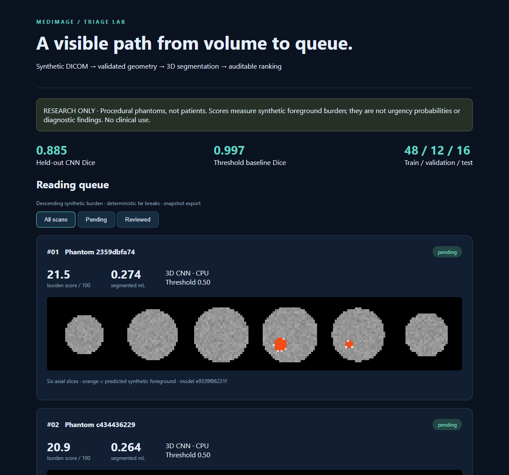
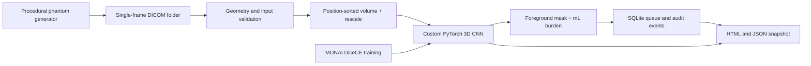

# MedImage Triage Lab

**A reproducible, synthetic-only DICOM workflow that connects 3D segmentation to an auditable reading queue.**

[](https://github.com/dileepreddy27/medimage-triage-lab/actions/workflows/ci.yml)

Medical imaging workflows need more than a model: reliable volume assembly, explicit failure handling, traceable predictions, and a queue whose ordering can be explained. This project implements that complete path on small procedural phantoms. It is an engineering research demonstration, **not a diagnostic device**. There are no patient images, clinical accuracy claims, or claims of HIPAA, regulatory, or PACS conformance.



## What runs

- Generate original CT-like DICOM series with known foreground masks and negative cases.
- Validate a narrow single-frame DICOM contract; sort slices by physical position, apply linear intensity rescaling, and reject mixed series, missing slices, duplicate positions, unsupported orientation, and non-synthetic inputs.
- Train a custom 1,969-parameter PyTorch 3D CNN using MONAI's combined Dice and binary cross-entropy loss on CPU. Select the checkpoint on validation data and evaluate once on separate test seeds.
- Compare held-out segmentation against a fixed 100 HU threshold baseline. Neither method detects a named disease.
- Compute segmented volume in mL, transform it into an explicit synthetic burden score, and insert scans into a persistent SQLite queue with content deduplication and model SHA-256 provenance.
- Mark a scan reviewed, record the state transition atomically, and export an interactive, self-contained HTML snapshot with real inference overlays and JSON queue data.

## Architecture



**Stack:** Python 3.11, PyTorch, MONAI, pydicom, NumPy, TorchVision (slice montage assembly), Pillow, SQLite, pytest, Ruff, Docker, GitHub Actions. TorchVision is used for visualization rather than a 2D pretrained medical model. There are no remote APIs or model downloads at runtime.

## Quick start

Use Python 3.11 in an isolated environment. Initial installation needs internet access; the workflow then runs offline.

```bash
python -m venv .venv
# macOS/Linux:
source .venv/bin/activate
# Windows PowerShell instead:
# .\.venv\Scripts\Activate.ps1
python -m pip install torch==2.6.0 torchvision==0.21.0 --index-url https://download.pytorch.org/whl/cpu
python -m pip install -e ".[dev]"
medimage demo --out work/demo --epochs 30
```

Open `work/demo/dashboard.html` in a browser. The directory must be new or empty: reruns never silently overwrite a demo. The run creates a real locally trained checkpoint, split-level metrics, six synthetic DICOM series, a SQLite database, and HTML/JSON snapshots. Small synthetic arrays keep the CPU demo practical; training time depends on the machine.

```bash
# Inspect queue and replay one series (idempotent)
medimage queue --db work/demo/queue.sqlite
medimage ingest work/demo/dicom/phantom-401 --model work/demo/model.pt --db work/demo/queue.sqlite
# Copy a full scan ID from the queue output
medimage review SCAN_ID --db work/demo/queue.sqlite
medimage report --db work/demo/queue.sqlite --model work/demo/model.pt --series-root work/demo/dicom --out work/demo/reviewed.html
```

Review records a research workflow state change; it does not certify a medical interpretation. The dashboard is an exported snapshot, not a live hospital system. Filters operate locally; re-export after CLI changes.

### Docker

```bash
docker build -t medimage .
docker run --name medimage-demo medimage
docker cp medimage-demo:/results/demo ./demo-export
docker rm medimage-demo
```

The container runs as an unprivileged user. No exposed ports or cloud resources are required. The CI container job builds the image and executes a one-epoch smoke demo.

## Evaluation design and evidence

The generator creates 24 × 32 × 32 volumes at 2 × 1 × 1 mm spacing: noisy low-intensity background, a soft-tissue-like ellipsoid, and optional bright foreground ellipsoids. These are geometric objects, **not anatomically realistic lesions**. Every fourth seed is a negative case.

| Split | Seeds | Cases | Purpose |
|---|---|---:|---|
| Train | 100–147 | 48 | Optimize weights |
| Validation | 200–211 | 12 | Choose checkpoint by mean Dice |
| Test | 300–315 | 16 | Held-out report, including 4 negatives |
| Workflow demo | 400–405 | 6 | DICOM round-trip and queue display |

The decision threshold is fixed at 0.5. No test case tunes it. Empty prediction/empty truth receives Dice 1; the metrics also report positive-only Dice and negative false-positive case count to avoid hiding those effects. All splits share the same procedural distribution, so test performance demonstrates pipeline consistency, not generalization to clinical images. The bright objects make the intensity threshold an intentionally strong baseline.

See [measured results](docs/RESULTS.md), [full metrics](docs/metrics.json), and [model card](docs/MODEL_CARD.md). The CI demo uses two epochs as a wiring check, not the published 30-epoch evaluation.

The completed local 30-epoch run achieved **0.8850 mean test Dice**, compared with **0.9973 for the fixed threshold baseline** on 16 synthetic cases. The baseline wins on this deliberately simple distribution. The CNN's positive-only mean Dice was 0.8467; none of the four negative cases had predicted foreground. These are synthetic segmentation results, not clinical accuracy estimates.

```bash
python -m ruff check .
python -m pytest -q
```

Tests exercise true DICOM serialization/decoding and real CPU training, alongside invalid geometry, rescaling, split isolation, negative cases, model shape, queue ordering, deduplication, provenance conflicts, rollback, and review transitions. Each test uses temporary data; no local checkpoint or database is required.

## Triage rule and persistence

`volume_mL = predicted_voxels × voxel_volume_mm3 / 1000`

`score = 100 × volume_mL / (volume_mL + 1)`

The score is a monotonic visualization of synthetic foreground burden. It is not calibrated risk, medical urgency, or model confidence. Queue ordering is descending score, then arrival time and content digest. Content hashes intentionally collapse identical volumes across different generated DICOM UIDs. Predictions are tied to the checkpoint hash; changing models requires a separate queue. Event records are append-only through the application API, but the database is **not tamper-proof**.

## Boundaries and tradeoffs

- **No clinical use:** no real patient dataset, diagnostic validation, clinical thresholds, privacy certification, or regulatory clearance. Synthetic tags are an input guard, not a de-identification service. Never feed patient data into this demo.
- **No PACS integration:** a local folder is the implemented ingestion boundary. DICOM networking, C-STORE, DICOMweb, HL7/FHIR, authentication, and hospital deployment are future work.
- **Fixture format:** generated files contain the metadata needed by this reader and pydicom. Full CT IOD conformance and interoperability with PACS viewers have not been validated.
- **Narrow volume contract:** exactly 24 axial uncompressed explicit little-endian CT slices, 32 × 32 pixels, fixed spacing, constant in-plane origin. Oblique, compressed, multiframe, irregular, and full-resolution clinical scans are rejected rather than silently resampled.
- **Tiny model:** two 3 × 3 × 3 convolutions and a 1 × 1 × 1 output head. This is not a trained MONAI U-Net, a lesion detector, or a pulmonary embolism system. No external pretrained weights are used.
- **Local workflow:** no service authentication, distributed workers, retention policy, encryption layer, or concurrency benchmark. Inference precedes a serialized queue transaction; concurrent duplicate requests may repeat computation but cannot create duplicate records.
- **No hardware claims:** CPU timing is a small local observation, not a throughput benchmark. CUDA and hospital-scale loads have not been tested.

## License and attribution

Original code, procedural fixture generator, and generated example visuals are MIT licensed. No patient or third-party image data are redistributed. Dependencies retain their own licenses; see [third-party notices](THIRD_PARTY_NOTICES.md). [Model card](docs/MODEL_CARD.md) documents the synthetic data and intended use. [Resume bullets](docs/RESUME_BULLETS.md) stay within implemented and measured capabilities.
